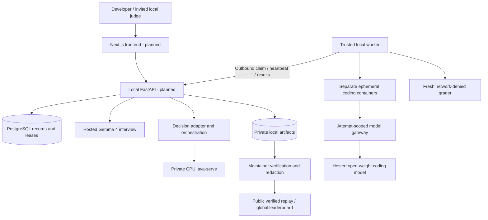
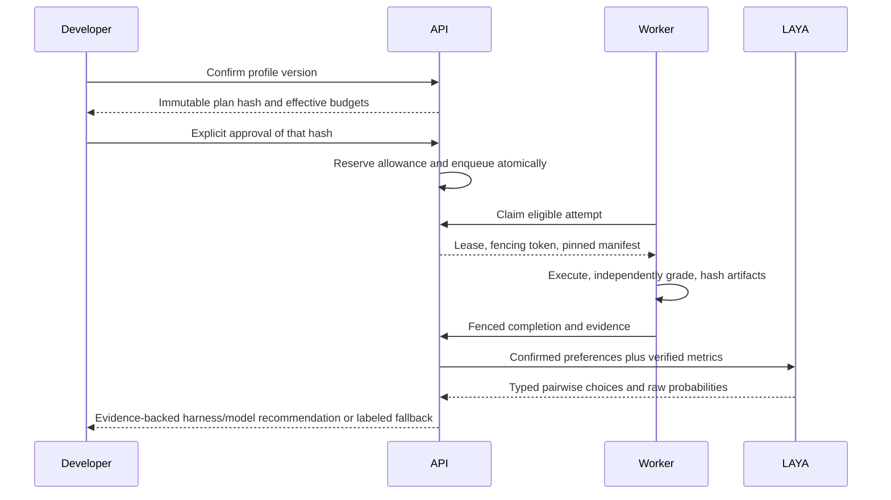

# Planned architecture

This design applies the accepted MVP decisions recorded in PRD v1.1. The amended PRD preserves the original requirements record and explicitly incorporates PostgreSQL leases, local CPU execution and public replay boundaries. No prototype or integration is claimed as validated here.

## Deployment

The arrows describe planned interfaces. Task containers have no route to LAYA, PostgreSQL, hidden graders, host credentials or Docker control. A public replay is a sanitized export and does not expose the local control plane.

The future frontend uses Next.js and TypeScript. The local control plane uses FastAPI, Pydantic v2, PostgreSQL and Alembic, with a Python worker using Docker Desktop's WSL2 backend on Windows 11. PostgreSQL holds durable queue state and fenced leases; Redis is excluded. Task execution is curated-only, CPU-only, and local.

The worker polls outbound for authorized work and uploads bounded evidence through the API. A public site serves redacted replay artifacts and documented recorded results. It cannot call a tunnel into the local API. Invited judges may use quota-limited sessions on the local system while the operator and worker are present. Live evaluation is unavailable when local dependencies are down.

## Inference boundaries

- Gemma interview: hosted Google AI Studio `gemma-4-26b-a4b-it`; provider support, license/terms, credentials, eligibility and budgets must pass the live probe.
- Coding comparison: OpenCode and Aider use the same hosted `Qwen3-Coder-30B-A3B-Instruct` endpoint and recorded model identifier. Adapter capability differences are disclosed.
- Decision: official `laya-serve` using a CPU-compatible typed-decision-only model, loopback `127.0.0.1:8001`, persistent model cache, at most 2 CPUs and 4 GiB memory. No public LAYA endpoint or GPU dependency.

No endpoint availability, free-tier entitlement or cost is presumed. Hosted requests remain disabled until credentials, actual eligibility, caps and provider conditions are verified. A failed LAYA startup or uncertain output produces a visible deterministic fallback.

## Request and execution path

1. Interview produces a versioned profile with evidence spans; developer edits and confirms.
2. Planning selects fixed curated global tasks and optional private task-matched tasks. Estimates use configured caps and verified pricing/usage only.
3. Approval freezes plan digest, profile, candidates, task versions and budgets.
4. API commits run requests and immutable manifests atomically.
5. Worker claims a bounded PostgreSQL lease with a monotonically increasing fencing token.
6. Worker starts a fresh hardened container, invokes one adapter and records bounded events.
7. Independent grading evaluates the patch using a grader unavailable to the coding agent.
8. Worker finalizes evidence only while its fencing token remains current; retries use new attempt IDs.
9. Deterministic preprocessing enforces constraints, comparability, direction and missing evidence. LAYA compares at most eight eligible candidates: at most 28 unordered pairs and 56 calls including reversed-order checks; deterministic fallback is recorded where required.
10. Public evidence enters an explicit redaction/review/publication path.

## API contract

All product endpoints are rooted at `/api/v1`; health and readiness are operational endpoints at `/api/v1/health` and `/api/v1/ready`. The generated contract in `packages/contracts/generated/openapi.json` is authoritative for endpoint names and methods. Versioned Pydantic schemas generate OpenAPI.

| Resource | Planned endpoints |
| --- | --- |
| Interview | POST /api/v1/interviews; POST /api/v1/interviews/{id}/messages |
| Profile | GET/PATCH /api/v1/profiles/{id}; POST /api/v1/profiles/{id}/confirm |
| Catalog | GET /api/v1/harnesses; GET /api/v1/models; GET /api/v1/tasks; GET /api/v1/leaderboard |
| Plan and approval | POST /api/v1/experiments/plan; POST /api/v1/plans/{id}/approve |
| Experiment | POST /api/v1/experiments; GET /api/v1/experiments/{id}; POST /api/v1/experiments/{id}/cancel |
| Run | GET /api/v1/runs/{id}; GET /api/v1/runs/{id}/artifacts |
| Decision | POST /api/v1/recommendations; GET /api/v1/recommendations/{id} |
| Worker | POST /api/v1/workers/claim; POST /api/v1/attempts/{attempt_id}/heartbeat; POST /api/v1/attempts/{attempt_id}/progress; POST /api/v1/attempts/{attempt_id}/artifacts; POST /api/v1/attempts/{attempt_id}/complete |
| Publication | POST /api/v1/publications |

Owner checks apply to private resources and artifacts. Approval and dispatch use idempotency keys and compare the full approved digest. Worker requests use scoped credentials stored outside task containers.

## Isolation and storage

Containers run non-root, drop capabilities, prohibit privileged mode and host Docker socket mounts, restrict CPU/memory/PIDs/disk/time and deny egress except a controlled model proxy. Provider credentials remain at the proxy/control plane boundary. Hidden graders and host sources are never exposed to task agents. Logs, patches and metrics are bounded and hash-addressed; local artifact storage is sufficient for the initial live session, with immutable reviewed static exports for public replay. S3 integration is deferred.

## Observability and failure behavior

Structured events include experiment/run/attempt IDs, manifest digest and lease token without secrets. Readiness distinguishes database, worker, Docker, provider and LAYA readiness. Unavailable LAYA alone does not masquerade as a measured LAYA recommendation. Quota exhaustion, timeout, cancellation, stale lease and provider denial remain explicit outcomes.

## Repository module layout

`apps/web`, `apps/api` and `apps/worker` are entry points. `packages/domain` owns pure state/constraint logic; `contracts` owns wire types; `interview` owns Gemma/provider extraction; `decision` owns typed LAYA orchestration and the audited baseline; `evaluation` owns controlled execution/grading; `harness_adapters` owns the adapter contract; `persistence` owns PostgreSQL transactions/leases; `artifacts` owns verified private storage and sanitized export. Callers use module entry points rather than internal imports. Domain logic does not import HTTP, Docker or persistence implementations.

`benchmarks` separates manifests, visible fixtures, graders and reference fixes. `prototypes` contains independently runnable integration probes, whose fixtures are marked synthetic. `tests/integration`, `tests/runner`, and `tests/e2e` validate the accepted seams. Unimplemented module directories are design reservations, not runnable placeholders.

## Decision records and specifications

Eight accepted decision records cover [local execution](adr/001-local-execution.md), [PostgreSQL leases](adr/002-postgres-leases.md), [model boundaries](adr/003-model-boundaries.md), [typed selection](adr/004-typed-selection.md), [public evidence](adr/005-public-evidence.md), [immutable approval](adr/006-immutable-approval.md), [benchmark method](adr/007-benchmark-method.md) and [license/release](adr/008-license-release.md). Detailed contracts include [execution](specs/03-execution.md), [decision](specs/04-decision.md) and [release/traceability](specs/08-release-traceability.md).

